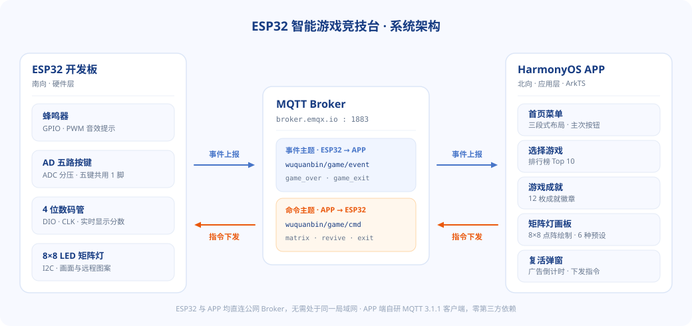

# ESP32 智能游戏竞技台

鸿蒙应用开发期末大作业 —— ESP32 开发板与 HarmonyOS 手机 APP 通过 MQTT 实时双向通信：手机端负责选游戏、看成就、管排行榜，还能远程给开发板上的 8×8 矩阵灯画图。



|  |  |
| --- | --- |
| **技术栈** | ArkTS · ArkUI 声明式 UI · HarmonyOS 6.0.2(22) |
| **通信** | MQTT 3.1.1 · 基于 TCP Socket 自研客户端，零第三方依赖 |
| **Broker** | `broker.emqx.io:1883` |
| **成员** | 巫泉彬（25215150314）· 蓝钿玉 |

<br>

## 功能

### APP 端

| 页面 | 说明 |
| --- | --- |
| 首页菜单 | 三段式布局，主按钮「选择游戏」+ 次按钮「游戏成就」「其他玩法」 |
| 选择游戏 | Swiper 滑动切换四款游戏，显示最新对局与排行榜 Top 10 |
| 游戏成就 | 每款游戏 3 级成就共 12 枚，按分数门槛自动解锁 |
| 其他玩法 | 8×8 点阵绘制，6 种预设图案，实时下发到开发板矩阵灯 |
| 复活弹窗 | 收到 `game_over` 后弹出，5 秒广告倒计时结束可下发复活指令 |

支持四款游戏：**贪吃蛇** · **俄罗斯方块** · **小恐龙 Dino** · **飞机大战**

### 硬件端

| 外设 | 接口 | 作用 |
| --- | --- | --- |
| 蜂鸣器 | GPIO · PWM | 得分、碰撞、结束时的音效提示 |
| AD 五路按键 | ADC 电阻分压 | 上下左右 + 确认，五键共用 1 个 ADC 引脚 |
| 4 位数码管 | DIO · CLK（板载 TM1637） | 实时显示当前分数 |
| 8×8 LED 矩阵灯 | I2C（SDA · SCL） | 游戏画面 + APP 远程下发的图案 |

<br>

## MQTT 通信

| 主题 | 方向 | 内容 |
| --- | --- | --- |
| `wuquanbin/game/event` | ESP32 → APP | 游戏结束、退出菜单 |
| `wuquanbin/game/cmd` | APP → ESP32 | 矩阵灯控制、复活、退出 |

**ESP32 → APP**　游戏结束 / 退出菜单

```json
{"type":"game_over","game":"snake","score":85}
{"type":"game_exit","game":"tetris","score":240}
```

**APP → ESP32**　矩阵灯控制 / 复活 / 退出

```json
{"type":"matrix","action":"pattern","name":"heart","x":-1,"y":-1,"on":0,"rows":[0,102,255,255,126,60,24,0]}
{"type":"revive","game":"snake"}
{"type":"exit","game":"snake"}
```

矩阵灯 `action` 取值：`pixel` 单点开关 · `pattern` 预设图案 · `clear` 清空 · `fill` 全部点亮 · `frame` 整帧下发。`rows` 始终携带完整 8 字节帧，保证开发板与 APP 两端状态一致。

<br>

## 项目结构

```text
entry/src/main/ets/
├── common/                     # 业务与通信层
│   ├── MqttClient.ets          # 自研 MQTT 3.1.1 客户端（555 行）
│   ├── AppConstants.ets        # 主题色、MQTT 配置、预设图案
│   ├── GameDataModel.ets       # 数据模型与事件解析
│   └── DatabaseHelper.ets      # preferences 本地存储
├── components/                 # UI 组件
│   ├── PageShell.ets           # 子页通用导航条
│   ├── HomeMenu.ets            # 首页菜单
│   ├── SelectGamePage.ets      # 选游戏 + 排行榜
│   ├── AchievementPage.ets     # 成就页
│   ├── MatrixPage.ets          # 矩阵灯画板
│   └── AdReviveDialog.ets      # 复活弹窗
└── pages/Index.ets             # 入口：路由 + 全局状态 + MQTT
```

共 13 个 `.ets` 文件，约 2800 行 ArkTS。

仓库根目录同时存放两端代码：ESP32 固件（`*.c` `*.h` `BUILD.gn` `Kconfig`）与 HarmonyOS APP 工程（`entry/` `AppScope/`），另有 `assets/` 配图与实践报告、期末汇报 PPT。

<br>

## 核心实现：自研 MQTT 客户端

HarmonyOS 没有内置 MQTT 库，`MqttClient.ets` 基于 `@kit.NetworkKit` 的 TCP Socket 从零实现 MQTT 3.1.1 协议，不引入任何第三方依赖。

| 能力 | 实现方式 |
| --- | --- |
| DNS 解析 | `connection.getAddressesByName()`，逐个尝试 IPv4 地址直到连通 |
| 报文收发 | 手工拼装 CONNECT / SUBSCRIBE / PUBLISH，解析 CONNACK / SUBACK / PINGRESP |
| 粘包拆包 | `pendingBuffer` 缓存 + 变长 Remaining Length 解析循环，TCP 分片不丢包 |
| 心跳保活 | 按 `keepAlive / 2` 定时发送 PINGREQ |
| 超时管理 | `PendingWaiter` 统一处理回调、超时与资源清理 |

<br>

## 运行

需要 **DevEco Studio 6.0+**（HarmonyOS SDK API 22）。

1. DevEco Studio 打开工程根目录，等待 Hvigor 同步完成
2. 手机开启「开发者选项 → USB 调试」并连接电脑
3. `File > Project Structure > Signing Configs` 勾选自动签名并登录华为开发者账号
4. 点击 Run 部署到真机

**联调**：手机与 ESP32 各自直连公网 Broker，**不需要处于同一局域网**。用 MQTTX 订阅 `wuquanbin/game/#`，可实时查看两侧收发的报文。

<br>

## 说明

- 本仓库两端代码齐备：ESP32 固件在根目录，APP 端在 `entry/`
- 原始工程包 `esp32_games.zip`（118MB）超出 GitHub 单文件限制未入库；其中 90% 是编译产物与依赖缓存，源码已完整解出到仓库根目录
- MQTT 断开后不会自动重连，需在「其他玩法」页手动点「连接 MQTT」

<br>

---

广东东软学院 · 鸿蒙应用开发课程 ｜ 任课教师：徐捷 ｜ 巫泉彬 · 蓝钿玉
